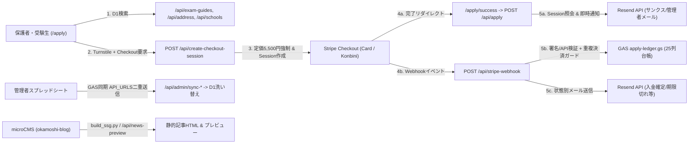

# [スコープ: 個別案件 / okayama-moshi] 00_ACTIVE_MASTER_SPEC.md

> **【最優先・唯一の憲法】** 本ドキュメントは本番運用サイト「岡山県統一模擬試験（おかもし）」における最新の確定仕様マスター台帳（単一正本）です。新しい変更指示（案B）が本仕様（案A）と矛盾する場合は、着工前に必ず停止してユーザー確認を行い、承認後に旧仕様記述を完全上書きして末尾 ADR に記録してください。
> また本リポジトリはリポジトリ直下 `.` がそのまま Cloudflare Pages の公開ルートとなるため、機密値（`.env` / `.dev.vars` / 各種APIキー）や非公開ドキュメントの露出厳禁ルールを最優先で順守します。

---

## 1. 案件識別 ＆ 環境情報

- **クライアント名**: 岡山県統一模擬試験
- **運営組織**: 岡山県統一模擬試験実行委員会（中央教育研究所株式会社）
  - 所在地: 〒730-0013 広島県広島市中区八丁堀15番6号 広島ちゅうぎんビル3階
  - 連絡先: TEL `082-227-3999`（平日 10:00〜18:00） / MAIL `info@okayama-moshi.com`
- **案件キー**: `okayama-moshi`
- **ノート種別 / プレフィックス**: `[本番運用]`
- **ノートブック表示名**: `[本番運用] 岡山県統一模擬試験（okayama-moshi）`
- **本番URL**: https://okayama-moshi.com/
- **プレビューURL**: https://feature-idea-b.okamoshi-hp.pages.dev/
- **ホスティング / デプロイ構成**:
  - Cloudflare Pages（プロジェクト名: `okamoshi-hp` / `wrangler.toml.example` の定義名: `okamoshi`、公開出力ディレクトリ: `.`、互換日: `2025-01-01`）
  - 本番ブランチ: `main`（カスタムドメイン `https://okayama-moshi.com`）
  - プレビューブランチ: `feature/idea-b`（固定エイリアス `https://feature-idea-b.okamoshi-hp.pages.dev`）
  - **ブランチ完全同期ルール**: サイト改修・本番反映時は、必ず `feature/idea-b` と `main` の双方が同一コミット（同一 SHA）になるよう同期・プッシュする。

---

## 2. 技術スタック全体像

| レイヤー | 採用技術・構成 | 詳細 |
| :--- | :--- | :--- |
| **フロントエンド** | Vanilla HTML5 / Vanilla JS（ES5〜ES2022） | フレームワーク非依存の軽量構成。共通ヘッダー (`js/header.js`)、追従CTA (`js/floating-cta.js`)、会場整形 (`js/venue-format.js`)、日時シミュレーション (`js/common-date.js`)、サイドバーウィジェット (`js/sidebar-exam-widget.js`)、申込フォーム (`js/apply-form.js`)、申込完了後処理 (`js/apply-success.js`)、実施塾検索 (`js/schools-search.js`) |
| **CSS / デザイン** | Tailwind CSS v3.4.17 ＋ `css/input.css` → `css/style.min.css` | スタンドアロン Tailwind CLI (`bin/tailwindcss`) で `tailwind.config.js`（全ページ共通トークン統合済み）からビルド。トップページ `index.html` は `<!-- INLINE_CSS:style.min.css START -->` でインライン展開、全下層ページは `<link rel="stylesheet" href="/css/style.min.css">` を参照（`cdn.tailwindcss.com` 完全撤廃） |
| **SSG（静的記事生成）** | Custom Python 3 SSG (`scripts/build.py` / `scripts/build_ssg.py` / `scripts/generate_preview_page.py`) | microCMS (`okamoshi-blog` / `blogs`) から記事取得し、`news/[id]/index.html`・`news.html`・`news/index.html`・`index.html`・`lp/index.html`・`sitemap.xml`・`news/preview/index.html` を静的生成 |
| **API / サーバーレス** | Cloudflare Pages Functions (`functions/**/*.ts`) | TypeScript 実装。Workers Runtime 上で Stripe Checkout、Webhook 検証、D1 検索・同期・冪等性ロック、Resend メール送信（`Idempotency-Key` 対応）、Turnstile 検証、microCMS プレビュープロキシを実行 |
| **データベース** | Cloudflare D1 (`okamoshi-master`, binding: `DB`) | SQLite ベースの分散 DB。マイグレーション `migrations/0001`〜`0005` で管理（郵便番号約12.4万件・全国学校コード約2.9万件・実施塾119件・模試日程/会場/時間割/出題範囲・初回メール冪等性管理 `apply_initial_emails`） |
| **決済** | Stripe Checkout & Webhooks (`POST /v1/checkout/sessions`, `/v1/customers`) | クレジットカード決済 ＆ コンビニ決済（払込期限・店舗別払込番号対応）。サーバー側正規定価 `5,500円` 強制・HMAC-SHA256 署名検証・API再照会 |
| **メール配信** | Resend API (`https://api.resend.com/emails`) | `functions/_shared/resend.ts` で 600ms インターバル制御＋ 429/5xx 最大3回自動リトライ。管理者宛通知・申込者サンクス・入金確定・期限切れ・お問い合わせ自動返信を送信 |
| **ボット対策** | Cloudflare Turnstile (`https://challenges.cloudflare.com/turnstile/v0/siteverify`) | `cf-turnstile`（`data-size="flexible"`, `data-appearance="interaction-only"`）を申込フォーム・お問い合わせフォームに組込み、サーバー側 `verifyTurnstile()` で検証 |
| **CMS / 台帳連携** | microCMS (`okamoshi-blog`) ＆ Google Apps Script (`gas/`) | Google スプレッドシートから D1 への洗い替え同期（模試案内・実施塾一覧）、Stripe Webhook からの受付台帳スプレッドシート 25 列自動追記/更新（`apply-ledger.gs`）、および台帳上の運用 GAS 4本（`MailSender.gs`: Resend Batch一斉/スケジュール配信＆オプトアウト、`MemberIdManager.gs`: Gemini AI名寄せ自動採番＆電話番号整形、`alignPastExamineesSheet.gs`: 過去受験者31列整形、`MarketingReport.gs`: GA4/GSC/Clarity/台帳集計＋Gemini 3系分析の日次Google Chat速報） |
| **動画・メディア** | Cloudflare R2 (`pub-ba61870bbe1442af87f84c258e756736.r2.dev`) ＆ `scripts/optimize_images.py` | 申込手順解説動画 `apply-guide.mp4` の遅延ロード再生、PIL + macOS `sips` による AVIF/WebP 最適化 |
| **計測** | Google Analytics 4 (`GT-NBJ63L9J` / `G-QCFQWJHMQD`) ＆ Microsoft Clarity (`z5nnqjwyks`) | `requestIdleCallback` ＋初回操作イベントによる完全遅延ロード（初期メインスレッド TBT 0ms 化） |
| **品質ゲート / CI** | Playwright E2E ＋ 静的検査 ＋ TypeScript ＋ GitHub Actions | `scripts/smart-quality-gate.mjs`（PREVIEW / FAST / FULL 3モード）、Git `pre-push` フック物理ロック、`.github/workflows/ci.yml` |

---

## 3. API エンドポイント仕様 (`functions/api/`)

| エンドポイント | メソッド | 認証・ガード | 役割・データソース |
| :--- | :--- | :--- | :--- |
| `/api/exam-guides` | `GET` | 公開（CDN `s-maxage=300, stale-while-revalidate=86400`） | D1 (`exam_schedules`, `exam_venues`, `exam_timetables`, `exam_scopes`) を学年別（`c3`, `c2`, `c1`, `p6`）階層 JSON で配信。`?grade=`, `?month=`, `?flat=1` 対応 |
| `/api/cram-schools` | `GET` | 公開（CDN `max-age=60, s-maxage=60`） | D1 (`cram_schools`) から実施塾一覧を学区別グループ付きで配信。`?area=` 絞り込み対応 |
| `/api/address` | `GET` | 公開（Edge Cache `86400s`） | D1 (`zip_codes`) から 7 桁郵便番号（全角・ハイフン正規化）で都道府県・市区町村・町域（複数町域時は共通接頭辞）を返却 |
| `/api/schools` | `GET` | 公開（`no-cache, no-store`） | D1 (`schools`) から文科省学校コード準拠の小・中学校を AND 部分一致検索（最大15件、半角→全角自動変換、`type=junior/elementary`、`pref` / `all` 切替） |
| `/api/news-preview` | `GET` | サーバー環境変数 `MICROCMS_API_KEY` | microCMS 記事の下書きプレビュー取得プロキシ（`?id=&draftKey=`、`Cache-Control: no-store`） |
| `/api/create-checkout-session` | `POST` | Turnstile 検証 ＋ コンビニ締切二重ガード ＋ 在籍校名ガード | 正規定価 `5,500円` をサーバー強制し、`functions/_shared/form-guards.ts` で在籍校名バリデーション（空欄・生徒/保護者名一致のみ HTTP 400 ブロック、略称・候補外等の自由入力は許容）および住所重複クレンジングを実施した上で Stripe Customer 作成＋ Checkout Session（`card` / `konbini`）を生成 |
| `/api/apply` | `POST` | Stripe `session_id` 実在・決済ステータス厳格検証 ＋ 旧サイト除外ガード ＋ D1 冪等性ロック | 完了画面（`/apply/success`）から呼び出され、共通モジュール `apply-initial-mail.ts` 経由で初回受付メールを1回のみ送信（既送信時は `already_sent: true` でスキップ、GAS 台帳登録は Webhook に一本化） |
| `/api/stripe-webhook` | `POST` | `Stripe-Signature` HMAC-SHA256 検証（300秒許容・定時間比較） ＋ Stripe API 再取得 ＋ 旧サイト除外ガード ＋ D1 冪等性ロック | `checkout.session.completed`, `async_payment_succeeded`, `async_payment_failed`, `expired` を処理し、GAS 台帳 25 列の `create` / `update` と Resend メール通知（完了画面未到達時も確実に初回メール送信、`Idempotency-Key` 付与）を実行 |
| `/api/contact` | `POST` | Turnstile 検証 | 個人・塾/学校団体のお問い合わせを受付け、Resend で `CONTACT_ADMIN_EMAILS` 全宛先へ通知＋ユーザーへ自動返信メールを送信 |
| `/api/admin/sync-exam-guides` | `POST` | `x-sync-secret` / `Bearer` / `body.secret` (`EXAM_GUIDES_SYNC_SECRET`) | GAS (`sync-exam-guides.js`) から送信された模試4階層データを D1 へ全件洗い替え（孫→子→親削除、80文単位チャンク INSERT） |
| `/api/admin/sync-cram-schools` | `POST` | `x-sync-secret` / `Bearer` / `body.secret` (`CRAM_SCHOOLS_SYNC_SECRET`) | GAS (`sync-cram-schools.js`) から送信された実施塾一覧を D1 (`cram_schools`) へ全件洗い替え（50件単位チャンク INSERT） |

---

## 4. Cloudflare D1 データベーススキーマ (`okamoshi-master` / `migrations/`)

- **マイグレーション履歴**:
  - `0001_create_master_tables.sql`: `zip_codes`（郵便番号マスター、`idx_zip_code`）、`schools`（文科省13桁学校コード PK、`idx_school_name`, `idx_school_type_pref`）
  - `0002_create_cram_schools.sql`: `cram_schools`（`id`, `display_order`, `area_id`, `area_name`, `name`, `website_url`, `phone_number`, タイムスタンプ）
  - `0003_create_exam_tables.sql`: 模試案内 4 テーブル群（外部キー `ON DELETE CASCADE`）
    1. `exam_schedules`（`id` 例 `c3_10`, `grade_code`, `grade_name`, `issue_name`, `title`, `catch_copy`, `announcement`, `fee`, `fee_note`, `subjects_note`, `apply_deadline`, `ticket_shipping_date`, `ticket_shipping_note`, `home_return_deadline`, `result_shipping_date`, `result_shipping_note`, `sort_order`）
    2. `exam_venues`（`id` 例 `c3_10_okayama`, `schedule_id`, `venue_type`, `venue_name`, `map_url`, `exam_date_start`, `exam_date_end`, `belongings`, `notice`, `deadline_home`, `sort_order`）
    3. `exam_timetables`（`id` 例 `c3_10_okayama_1`, `venue_id`, `item_name`, `time_range`, `sort_order`）
    4. `exam_scopes`（`id` 例 `c3_10_kokugo`, `schedule_id`, `subject`, `units`, `sort_order`）
  - `0004_add_home_return_deadline.sql`: `exam_schedules` へ `home_return_deadline TEXT` カラムを追加
  - `0005_create_apply_initial_emails.sql`: 初回受付メール（申込者サンクス＋管理者通知）送信冪等性管理テーブル `apply_initial_emails`（`session_id` PK, `status`, `source`, `admin_mail_id`, `applicant_mail_id`, `attempts`, `sent_at` 等）および `idx_apply_initial_emails_status_updated` インデックスを作成

---

## 5. 環境変数・シークレット台帳（キー名のみ管理）

> **セキュリティ原則**: シークレット値は一切コードやドキュメントに記載しない。Cloudflare Pages ダッシュボード環境変数および GAS スクリプトプロパティのみで管理する。

### 5.1 Cloudflare Pages バインディング・環境変数 (`functions/_shared/env.ts`)
| 変数名 | 種別 | 用途 |
| :--- | :--- | :--- |
| `DB` | D1 Binding | `okamoshi-master` データベース接続 |
| `STRIPE_SECRET_KEY` | Secret | Stripe REST API 呼び出し（Checkout Session 作成・Session/PaymentIntent 再検証） |
| `STRIPE_WEBHOOK_SECRET` | Secret | Stripe Webhook HMAC-SHA256 署名検証 |
| `RESEND_API_KEY` | Secret | Resend メール送信 API キー（フォールバック候補: `RESEND_KEY`, `RESEND_TOKEN`） |
| `RESEND_FROM_EMAIL` | Env | 送信元表示アドレス（`resend.dev` テストドメイン時は強制的に `岡山県統一模擬試験 <info@okayama-moshi.com>` へフォールバック） |
| `ADMIN_EMAIL` | Env | 申込通知の管理者受信先（未設定時 `info@okayama-moshi.com`） |
| `CONTACT_ADMIN_EMAILS` | Env | お問い合わせ管理者通知先（カンマ区切り複数宛先対応） |
| `TURNSTILE_SECRET_KEY` | Secret | Cloudflare Turnstile siteverify 検証用シークレット（※公開側 sitekey は `0x4AAAAAAFUVxr1HR8KQNRY0`） |
| `GAS_APPLY_URL` | Env/Secret | 申込受付台帳 GAS Web アプリ URL（未設定時は `env.ts` の `DEFAULT_GAS_URL` を使用） |
| `GAS_SHARED_SECRET` | Secret | GAS 申込台帳との認証トークン照合 |
| `EXAM_GUIDES_SYNC_SECRET` | Secret | 模試日程 GAS 同期エンドポイント認証シークレット |
| `CRAM_SCHOOLS_SYNC_SECRET` | Secret | 実施塾 GAS 同期エンドポイント認証シークレット |
| `MICROCMS_API_KEY` | Secret | microCMS 記事・下書きプレビュー取得（SSG ビルド環境変数 ＆ `/api/news-preview` 用） |
| `MICROCMS_SERVICE_DOMAIN` | Env | microCMS サービスドメイン（既定値 `okamoshi-blog`） |
| `MICROCMS_ENDPOINT` | Env | microCMS エンドポイント名（既定値 `blogs`） |

### 5.2 GAS スクリプトプロパティ (`gas/`)
| スクリプト | プロパティ名 | 用途 |
| :--- | :--- | :--- |
| `gas/apply-ledger.gs` | `SHARED_SECRET` | `GAS_SHARED_SECRET` と一致必須 |
| `gas/apply-ledger.gs` | `SHEET_NAME` / `SPREADSHEET_ID` | 台帳出力先シート・スプレッドシート指定（任意） |
| `gas/sync-exam-guides.js` | `SYNC_SECRET` | `EXAM_GUIDES_SYNC_SECRET` と一致必須 |
| `gas/sync-cram-schools.js` | `SYNC_SECRET` | `CRAM_SCHOOLS_SYNC_SECRET` と一致必須 |
| `gas/MailSender.gs` | `RESEND_API_KEY` | Resend 単発・Batch API（`/emails/batch`）メール配信用 API キー |
| `gas/MailSender.gs` | `SHARED_SECRET` / `WEBAPP_URL` | ワンクリック配信停止リンクの SHA-256 署名ソルトおよび Web アプリベース URL（未設定時自動取得） |
| `gas/MailSender.gs` | `SHEET_NAME` / `SPREADSHEET_ID` | 台帳シート名（既定 `main`）・スプレッドシート ID（任意） |
| `gas/MemberIdManager.gs` | `GEMINI_API_KEY` | 受験番号（会員No）名寄せ判定用 Gemini API キー（未設定時は `⚠️要確認` フォールバック） |
| `gas/MemberIdManager.gs` | `SHEET_NAME` / `SPREADSHEET_ID` | `apply-ledger.gs` の `getSheet_()` 経由で参照 |
| `gas/alignPastExamineesSheet.gs` | （なし） | アクティブスプレッドシートの `main` / `過去受験者` タブを直接参照 |
| `gas/MarketingReport.gs` | `GA4_PROPERTY_ID` | GA4 Data API (`AnalyticsData.Properties.runReport`) 対象プロパティ ID |
| `gas/MarketingReport.gs` | `SEARCH_CONSOLE_SITE_URL` | Google Search Console REST API 対象サイト URL |
| `gas/MarketingReport.gs` | `CLARITY_API_TOKEN` | Microsoft Clarity Data Export API v1 トークン（任意・未設定時スキップ、6時間キャッシュ） |
| `gas/MarketingReport.gs` | `GEMINI_API_KEY` | 日次マーケティング分析用 Gemini API キー（`x-goog-api-key` ヘッダー送信、3系カスケード） |
| `gas/MarketingReport.gs` | `GOOGLE_CHAT_WEBHOOK_URL` | 日次速報の Google Chat 投稿先 Incoming Webhook URL |
| `gas/MarketingReport.gs` | `SHEET_NAME` / `DAILY_REPORT_LAST_SENT_DATE` / `DAILY_REPORT_RETRY_COUNT` | 台帳シート名（既定 `main`）および二重送信ガード・503リトライ回数管理（自動更新） |

---

## 6. 主要機能とエンドツーエンド・データフロー

### 6.1 個人申込・Stripe Checkout 決済フロー
1. `/apply/`（`apply/index.html`）が `/api/exam-guides` を取得し、学年（小6・中1・中2・中3）ごとの受付中模試と選択可能会場を動的構築する。入力途中の情報は `localStorage` に自動保存され再訪問時に復元される。
2. 郵便番号7桁（全角・ハイフン自動正規化）入力で `/api/address` を呼び出して都道府県・市区町村・町域を自動補完し、在籍校欄（`#currentSchool`）では `/api/schools` から全国・岡山県優先で学校名サジェストを提供する。
   - **在籍校欄オートフィル誤爆防止 ＆ 自由入力許容ガード**: `#currentSchool` に `autocomplete="off"`, `data-1p-ignore="true"`, `data-lpignore="true"`, `data-bwignore="true"`, `data-form-type="other"` を付与し、`js/apply-form.js` 側で生徒・保護者氏名/フリガナ 8 欄の `input`/`change` 連動によりブラウザ自動入力による人名混入を検知して直前の有効学校名へ復元または自動クリアする（`localStorage` 汚染保存・誤復元も防止）。またフロント（`js/apply-form.js`）とサーバー（`functions/_shared/form-guards.ts` 経由 `create-checkout-session.ts`）双方のバリデーションは「空欄」および「生徒・保護者の姓・名・フルネーム・セイ・メイ・フルフリガナとの一致（NFKC正規化・空白除去・カナ統一後）」の2条件のみをブロックし、学校キーワードを含まない略称（例：`操山`）・フリースクール・海外校等の自由入力は完全許容する。
   - **住所「町名・丁目・番地」重複クレンジング四層防御**: ① `js/apply-form.js`（郵便番号検索後の `#addressLine2Hint`・プレースホルダー案内、`blur` / 送信前処理・`parseJapaneseAddress` の `combineTownAndStreet`）、② `functions/_shared/form-guards.ts` 経由の `create-checkout-session.ts`、③ `stripe-webhook.ts` ＆ `apply-initial-mail.ts`、④ `gas/apply-ledger.gs`（`buildRow_` 内の `cleanAddressLine1_`）の4層で、町名結合重複（`長尾`+`長尾1441-1`）、空白挟み重複（`長尾 長尾1441-1`, `海吉 海吉1971-8`, `東川原 東川原368-1`）、末尾サフィックス重複（`福田町福田 福田2413-6`）、都道府県・市区町村丸ごとオートフィル混入（`岡山県英田郡西粟倉村長尾1441-1` 等）をすべて自動正規化する。
3. コンビニ決済の締切は「申込締切日の 3 日前 23:59:59」と定義されており、フロント側 UI 制御に加え、サーバー側 `create-checkout-session.ts` でも D1 (`exam_schedules.apply_deadline`) と payload を照合して締切超過のコンビニ決済を HTTP 400 で二重拒否する。
4. `create-checkout-session.ts` はクライアント送信金額を信用せず `OFFICIAL_EXAM_PRICE = 5500` 円 × 模試数で金額を強制計算し、1 模試＝1 レコードの JSON を `metadata.exam_1..N` に格納、Stripe Customer を事前作成して `card` または `konbini` の Checkout Session URL を返却する。あわせてフロントエンド（`js/apply-form.js` の `extractVenueTypeShort`）とサーバー共通モジュール（`functions/_shared/exam.ts` の `normalizeVenueShortName` / `normalizeIssueShortName`）により、Stripe `metadata`（`venue_type`, `issue_name`）および `metadata.exam_1..N`（`issue`, `venue`, `venue_type`）へ短縮表記を正規化格納する（Checkout 画面 `description` およびメール本文用 `label` には分かりやすさのため施設名・模試名称を維持）。

### 6.2 Stripe Webhook 処理 ＆ 冪等メール配信 ＆ 重複決済ガード ＆ 台帳連携
1. **初回受付メール冪等性機構 (`functions/_shared/apply-initial-mail.ts` + `apply_initial_emails`)**:
   - 完了画面（`/apply/success` → `POST /api/apply`）と Webhook（`checkout.session.completed` → `POST /api/stripe-webhook`）の双方が同一の `dispatchInitialApplicationEmails()` を呼び出す。
   - D1 `apply_initial_emails` テーブルへの `INSERT ... ON CONFLICT DO NOTHING` による原子ロック、同時着弾時の待機ポーリング、部分失敗（管理者成功・申込者失敗等）からの未送信側のみ補完リトライ、さらに `functions/_shared/resend.ts` の `Idempotency-Key` ヘッダー（ASCII 正規化）を組み合わせ、「リロード重複ゼロ」「同時競合ゼロ」「完了画面未到達時のコンビニ払込票メール未達ゼロ」を保証する。2回目以降は `already_sent: true` で安全スキップする（フロント `js/apply-success.js` 側も `sessionStorage` + `localStorage` で二重送信抑止）。
2. **Webhook (`functions/api/stripe-webhook.ts`)**:
   - `Stripe-Signature` を Web Crypto API HMAC-SHA256 で検証後、Stripe API から最新セッションを再取得。
   - **旧サイト決済除外ガード (`LegacySiteGuard`)**: 同一 Stripe 本番アカウントを共有する旧サイト経由の決済を `success_url` と `metadata`（`source === "okamoshi_apply"` 等）で識別し、新サイト以外のイベントは一切メール/GAS 連携せず 200 で無視する。
   - **イベント分岐**: `checkout.session.completed` は `action: "create"`（`paid` またはコンビニ `未入金`＋共通初回メール送信）、`async_payment_succeeded` は `action: "update"`（`paid` 更新＋入金確認メール送信）、`async_payment_failed` / `expired` はコンビニのみ `action: "update"`（`期限切れ` 更新）。`update` 系メールにも ASCII の `Idempotency-Key` を付与。
   - **コンビニ期限切れ時の重複決済ガード (`checkRecentPaidSession`)**: 直近 14 日以内に「同一生徒名（NFKC 正規化）＋ 同一メールアドレス ＋ 期限切れセッションに含まれる**全対象模試**」が別セッションで `paid` になっているかを Stripe API で照合する。100 件上限突破対策として **Phase 1（`customer_details[email]` 絞り込み最大 5 ページ）＋ Phase 2（`has_more` / `starting_after` 全件ページネーション最大 20 ページ＝2,000 件）** の2段階走査を実装。すべて決済済みなら保護者宛期限切れメールのみスキップし、GAS 台帳の該当古い行は `期限切れ` へ正しく更新する。
   - **GAS 台帳連携 (`gas/apply-ledger.gs`)**: `LockService.getScriptLock()` により同時実行競合を排他制御し、1 模試＝1 行・25 列（A〜Y列）で記録する。`stripe-webhook.ts` および `apply-ledger.gs`（`stripParens_()`）の多層ガードにより、台帳 C列（対象模試）＝月号のみ（例：`12月号`）、D列（受験会場）＝会場区分名のみ（例：`倉敷会場` / `自宅受験`）の短縮表記へ統一（通知メール本文の `r.label` は維持）。V列（町名・丁目・番地）は `cleanAddressLine1_()`（`stripPrefCityPrefix_()`・`findDuplicateTownSuffix_()` 含む）で都道府県・市区町村・重複町名を自動正規化して書き込む。さらに `buildRow_` の R列に `formatJapanesePhone_()` 電話番号整形、`createRows_` 書き込み直後に `SpreadsheetApp.flush()` ＋ `assignMemberIdsForRows_()` 自動採番フック（`try-catch` 安全ガード付きで Gemini API 遅延時も台帳追記は確実に成功）、`doGet(e)` に `?action=unsubscribe` 時の `MailSender.gs` `handleUnsubscribeGet_(e)` 委譲を統合。`updateStatus_` は B〜F 列 1 回 `getValues()` ＋ `getRangeList(...).setValue(...)` 1 回バッチ書き込みで `paid` 行保護を高速実行する。

### 6.3 お問い合わせフロー (`contact/` + `functions/api/contact.ts`)
- `/contact/`（タブ切替：個人・団体）、`/contact/individual/`、`/contact/organization/` の 3 ルートを用意。
- Turnstile 検証後、Resend により `CONTACT_ADMIN_EMAILS`（複数アドレス対応）へ通知し、問い合わせ者本人へ `await` 完了保証付きで自動返信メールを送信する。

### 6.4 GAS ⇔ D1 双方向（本番＋プレビュー同時）同期ルール
- `gas/sync-exam-guides.js` および `gas/sync-cram-schools.js` はいずれも `API_URLS` 配列に本番 (`https://okayama-moshi.com/...`) とプレビュー (`https://feature-idea-b.okamoshi-hp.pages.dev/...`) の 2 エンドポイントを保持し、スプレッドシート操作 1 回で両環境の D1 を同時に洗い替え同期する。**片方のみの削除は厳禁。**

### 6.5 microCMS SSG ＆ 下書きプレビューフロー
- `python3 scripts/build.py [--skip-images]` 実行時、`index.html` のインライン CSS マーカーを一旦 `<link>` に戻し、`build_ssg.py` で記事生成・トップ/LP/お知らせ/サイトマップ/プレビュー更新を行った後、Tailwind CLI (`bin/tailwindcss`) で全 HTML・`js/**/*.js` をスキャンして `css/style.min.css` をビルドし、最後に `index.html` へ `style.min.css` を再インライン化する。
- 本文中の `.mp4` リンク/プレーンURLは `<video controls preload="none">` プレイヤーへ自動変換され、カスタム装飾ボックス（`.box-fact`, `.box-action`, `.box-warning` 等）は同一段落内1改行マージと空行分割を正規化する。

### 6.6 受付台帳スプレッドシート運用 GAS 群 (`gas/`)
受付台帳スプレッドシートの Apps Script プロジェクトは以下 5 ファイルで構成される（`sync-exam-guides.js`・`sync-cram-schools.js` は別スプレッドシート側で稼働）：

| ファイル | 台帳上の役割 | 主な機能・メニュー / トリガー・関連シート |
| :--- | :--- | :--- |
| `gas/apply-ledger.gs`（=`コード.gs`） | 申込受付 Web アプリ | `doPost` により Stripe Webhook から A〜Y 列（25列）へ `create` / `update` を排他実行。C/D 列 `stripParens_` 短縮正規化、V列 `cleanAddressLine1_`（重複町名・地域名・末尾サフィックス自動除去）、`formatJapanesePhone_` 電話番号整形、`createRows_` の `assignMemberIdsForRows_` 安全自動採番フック（Z〜AB列）、`doGet(e)` の `?action=unsubscribe`（`MailSender.gs` `handleUnsubscribeGet_` 委譲）、`updateStatus_` バッチ最適化を統合 |
| `gas/MailSender.gs` | メール一斉・スケジュール配信 ＆ 配信停止 | メニュー `📧 おかもしメール配信`、`processScheduledEmailsCron`（毎朝9時台定時）、Resend Batch API（`BATCH_SIZE=80`）、`未申込:〇〇` 横断抽出、`handleUnsubscribeGet_(e)` ワンクリック停止。シート: `メール配信作成`, `メールテンプレート保管庫`, `配信スケジュール`, `配信ログ`, `配信停止リスト`, `過去受験者` |
| `gas/MemberIdManager.gs` | 会員No（受験番号）名寄せ・採番 ＆ 電話整形 | メニュー `🔢 受験番号・データ統合`（`onOpenTriggerForMember`）、`今年度_旧シート` 統合、Z〜AE 列（31列拡張）への Gemini 名寄せ＆MAX+1 採番、電話番号先頭0補完・ハイフン整形 |
| `gas/alignPastExamineesSheet.gs` | 過去受験者タブ 31 列整形 | 旧 25 列の `過去受験者` タブを `過去受験者_旧バックアップ`（非表示）へ退避後に `main` と同一 31 列構成へ変換 |
| `gas/MarketingReport.gs` | 日次マーケティング速報（Google Chat） | `runDailyMarketingReport`（`setupDailyMorningTrigger` により毎朝 6:37 JST、503時は12分間隔×最大3回自動リトライ）、`testRunDailyMarketingReportNow`。`main` + `模試基本情報`/`模試マスター` + GA4 + Search Console + Clarity（6hキャッシュ）を Gemini 3系（`gemini-3.5-flash-lite` 等）で分析し Google Chat へ投稿 |

- **運用・保守上の留意点**:
  1. `doGet(e)` の `?action=unsubscribe` 委譲（`MailSender.gs` `handleUnsubscribeGet_(e)`）および `createRows_` の `assignMemberIdsForRows_` / `formatJapanesePhone_` 連携は `gas/apply-ledger.gs` へ統合済み。本番スプレッドシートの `コード.gs` 反映時は Web アプリ URL 維持のため必ず既存デプロイの「新バージョン」編集で更新すること。
  2. `alignPastExamineesSheet()` 関数は `MailSender.gs`（L94〜235）と `alignPastExamineesSheet.gs`（L5〜151）の双方に重複定義されているため、修正時は片方のみの更新にならないよう留意すること（GAS 仕様上は後から読み込まれた定義で上書きされる）。

---

## 7. デザインシステム ＆ 運用絶対ルール（`GEMINI.md` 準拠要約）

1. **カラー規約**: メイン `#134230` (`brand-green`)・見出し濃色 `#064e3b` / `#1E3A2F`・CTA 専用バーントオレンジ `bg-orange-700 hover:bg-orange-800`・背景 `#F1F5F9`・カード `bg-white`・テキスト `slate-*`。Tailwind 標準 `blue-*` `indigo-*` `violet-*` `purple-*` `fuchsia-*` `pink-*` `cyan-*` `lime-*` `yellow-*` `stone-*` `neutral-*` `green-*` および `ALLOWED_HEX` 外の新規任意 HEX 追加を禁止。
2. **形状・可読性規約**: 角丸上限 **8px**（ピルのみ `rounded-full`）。重要テキスト（会場名・注釈・日程・注意事項）への `truncate` / `line-clamp-*` 禁止。セル内改行は `whitespace-pre-line break-words`、`※` 注釈は `0.85em` + `text-slate-500` で別要素分離、外部文字列の `innerHTML` 挿入時は必ず `js/venue-format.js` の `escapeHtml()` を通す。
3. **完了の定義（DoD）**: いかなるコード変更後も `python3 scripts/build.py --skip-images` および `npm run quality-gate:smart`（`main` プッシュ時は FULL MODE 強制・バイパス禁止）の全 PASS を必須とする。

---

## 8. 意思決定・仕様変更ログ（ADR）

- **[ADR-001] 2026-10-10 | D1 マスター配信基盤の構築**: 郵便番号（日本郵便 `utf_ken_all`）と全国学校コード（文科省）を Cloudflare D1 (`okamoshi-master`) へ格納し、`/api/address`・`/api/schools` の低遅延検索 API を確立（`migrations/0001`）。
- **[ADR-002] 2026-10-14 | 決済・通知・ボット防御セキュリティハードニング**: シークレット類のコード直書き撤廃、Stripe Checkout サーバー側正規定価 5,500 円強制、Webhook HMAC-SHA256 署名検証、`/api/apply` の `session_id` 検証、Turnstile 検証を必須化。
- **[ADR-003] 2026-10-29 | 実施塾・模試日程マスターの D1＋GAS 洗い替え統合**: `cram_schools` および `exam_schedules/venues/timetables/scopes` を D1 化し、GAS から本番・プレビュー両環境 `API_URLS` への同時同期と台帳 25 列 `apply-ledger.gs` を確定（`migrations/0002`, `0003`, `0004`）。
- **[ADR-004] 2026-10-31 | 静的品質ゲート＆スマート2段階ギア制御導入**: 静的検査・AIルール同期（`GEMINI.md` 正本）・TypeScript 型チェック・塾公式サイト URL 全件検査・Playwright（PC 1280px / SP 375px ＋ `@critical-forms`）・Git `pre-push` フックロックを統合。
- **[ADR-005] 2026-11-01 | 申込操作手順 R2 動画とファビコン・microCMS `.mp4` 埋め込み導入**: R2 ホスティング動画 `apply-guide.mp4` を `preload="none"` 遅延再生で組込み、学帽SVG/PNGファビコンを全ページ整備。
- **[ADR-006] 2026-11-02〜11-09 | 旧 WordPress URL からの完全 301 移行と 404 自動転送**: `_redirects` に旧 WP パス・模試案内旧スラッグ・非公開ファイル遮断ルールを整備し、`404.html` からのトップ即時リダイレクトを実装。
- **[ADR-007] 2026-11-03 | コンビニ期限切れ重複決済ガードの厳密化**: 期限切れ時の別セッション照合を「同一生徒＋同一メール＋期限切れに含まれる全対象模試」の完全一致条件に厳密化し、別決済済み時でも古い未入金行を GAS 側で確実に「期限切れ」更新する仕様へ確定。
- **[ADR-008] 2026-11-09〜11-11 | 本番 PSI/CWV・WCAG AA 高速化と計測遅延ロード**: AVIF/WebP 最適化、LCP プリロード、`index.html` への `style.min.css` インライン展開、GA4 (`GT-NBJ63L9J` / `G-QCFQWJHMQD`)・Clarity (`z5nnqjwyks`)・Google Fonts の遅延ロード、NEW バッジ背景 `#b5451f` 調整による A11y 100 点達成。
- **[ADR-009] 2026-11-12 | microCMS リッチエディタ装飾ボックス＆カスタムクラス正規化**: `.text-point-red` / `.text-brand-green` / `.marker-yellow` 追加と、単一 Shift+Enter 結合・段落/空行分離の両立を SSG と下書きプレビュー双方に実装。
- **[ADR-010] 2026-11-25 | Gemini Notebook 本番運用マスター台帳整備 ＆ 公開遮断**: `_redirects` へ `/docs/* /404.html 200` を追加し、`[本番運用] 岡山県統一模擬試験（okayama-moshi）` ノートブックへ全仕様・コード（機密除外済）のゼロ矛盾同期を実施。
- **[ADR-011] 2026-11-25 | 決済・メール冪等性/100件上限対策/GASバッチ最適化 ＆ 全ページ Tailwind Play CDN 脱却**: D1 `apply_initial_emails` テーブル（`migrations/0005`）＋ Resend `Idempotency-Key` による初回受付メールの未達・重複ゼロ化、`checkRecentPaidSession` の `customer_details[email]`＋最大2,000件ページネーション走査、`gas/apply-ledger.gs` `updateStatus_` のバッチ読み書き最適化、全31 HTML からの `cdn.tailwindcss.com` 撤去と `/css/style.min.css` 統一、`js/apply-form.js` / `js/apply-success.js` / `js/schools-search.js` 外部モジュール化、および品質ゲート CDN ゼロ強制・バックエンド単体テスト（`tests/unit/backend-hardening.test.mjs`）を追加。
- **[ADR-012] 2026-11-25 | 受付台帳スプレッドシート追加 GAS 4ファイルのリポジトリ一元管理 ＆ Gemini Notebook 完全同期**: `gas/MailSender.gs`, `gas/MemberIdManager.gs`, `gas/alignPastExamineesSheet.gs`, `gas/MarketingReport.gs` を Git 管理下へ取り込み、`00_ACTIVE_MASTER_SPEC.md` および `06_実装コードバンドル_FullStack_HTML_JS_Functions.md` に全文収録してゼロ矛盾ローテーション同期を実施。
- **[ADR-013] 2026-11-25 | 受付台帳C/D列短縮正規化（3層ガード）・GAS自動採番＆配信停止統合・外部塾URL一時タイムアウト耐性強化**: `functions/_shared/exam.ts`（`normalizeVenueShortName` / `normalizeIssueShortName`）・`js/apply-form.js`・`create-checkout-session.ts`・`stripe-webhook.ts`・`gas/apply-ledger.gs`（`stripParens_`）の多層ガードで台帳 C列＝月号のみ・D列＝会場区分名のみへ統一（メール本文 `r.label` は維持）。あわせて `gas/apply-ledger.gs` へ `doGet(e)` の `handleUnsubscribeGet_(e)` 委譲と `createRows_` からの `assignMemberIdsForRows_` 安全呼び出し（`try-catch`＋`SpreadsheetApp.flush`）・`formatJapanesePhone_` 連携を統合。また `scripts/check-juku-urls.mjs` で外部サーバー一時タイムアウト/502〜504のみ WARN 扱い（404/DNS失効/パーキング化等の明確なリンク切れ NG 検知は厳格維持）へ強化。
- **[ADR-014] 2026-11-25 | 在籍校名オートフィル誤爆防止・人名一致ブロック（自由入力・略称完全許容）＆ 住所町名重複クレンジング四層防御**: `apply/index.html` の `#currentSchool` にオートフィル誤認防止属性（`autocomplete="off"` + `data-1p-ignore="true"` / `data-lpignore="true"` / `data-bwignore="true"` / `data-form-type="other"`）を付与し、`js/apply-form.js` の氏名・フリガナ 8 欄連動による自動復元/クリアと `localStorage` 汚染防止を実装。フロント（`js/apply-form.js`）およびサーバー（`functions/_shared/form-guards.ts` 経由 `create-checkout-session.ts`）での学校名検証は「空欄」および「生徒・保護者の氏名・フリガナ一致」のみをブロックし、略称（例：`操山`）や候補外の自由入力はすべて許容。あわせて住所 V列（町名・丁目・番地）の町名重複・サフィックス重複（`福田町福田 福田2413-6` 等）・都道府県/市区町村重複オートフィルを `js/apply-form.js`・`create-checkout-session.ts`・`stripe-webhook.ts` / `apply-initial-mail.ts`・`gas/apply-ledger.gs`（`cleanAddressLine1_`）の四層で自動正規化（単体テスト・E2E 検証追加）。
